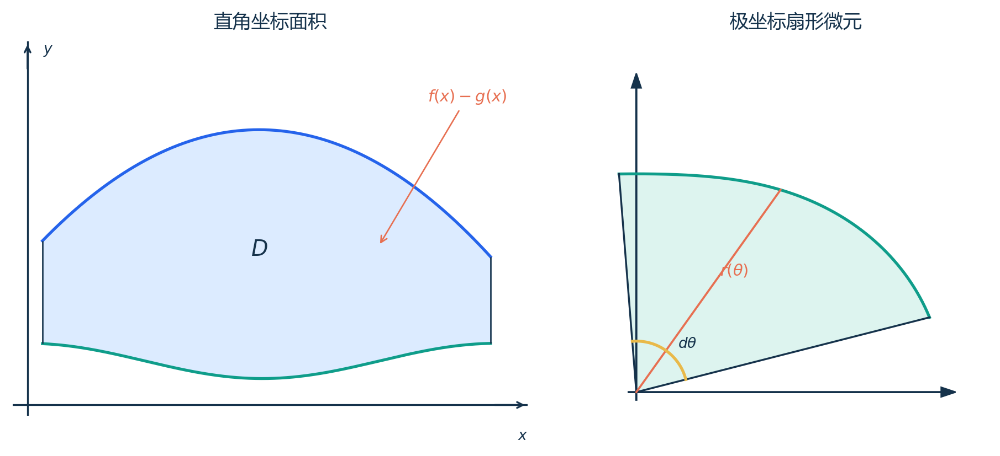
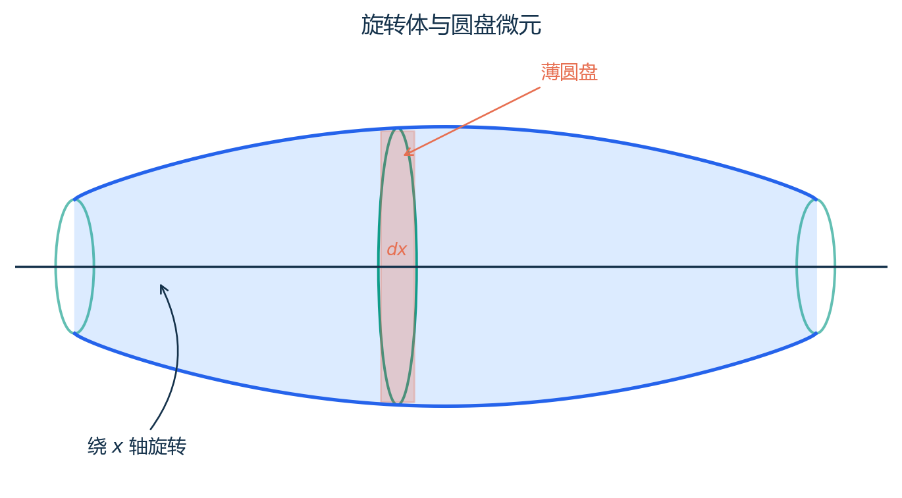
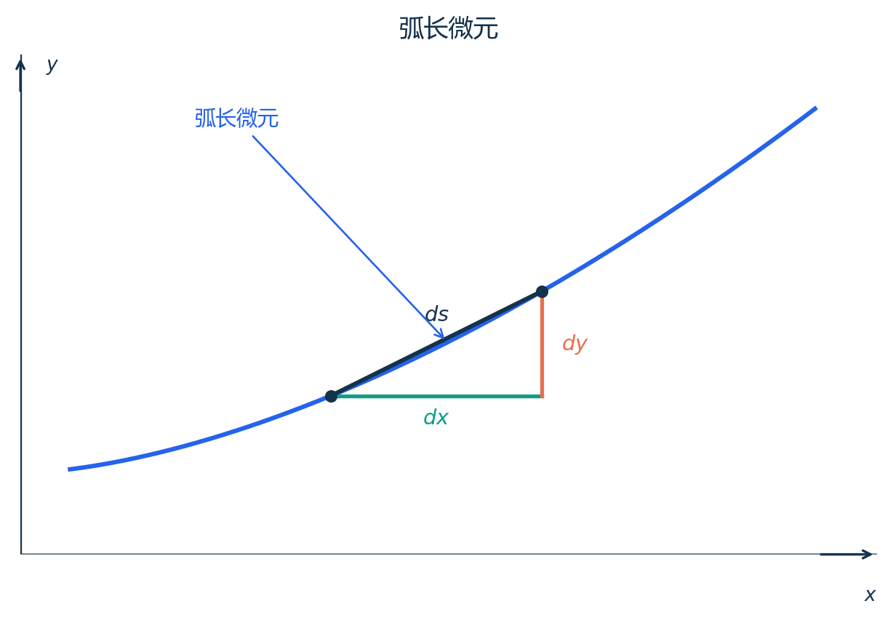
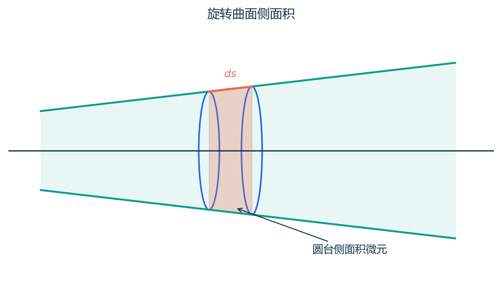
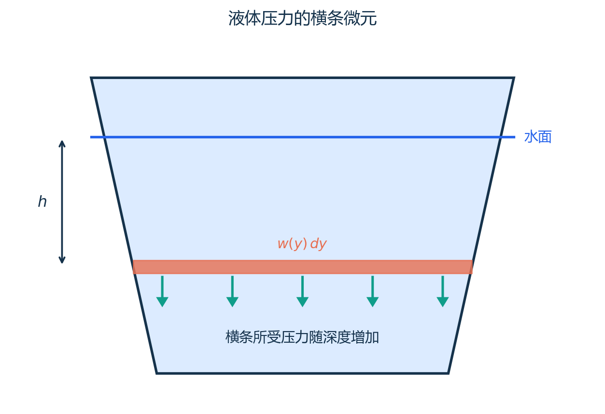

# 一元函数积分学：应用

> 范围基线：2026 考研数学二大纲。包括几何量和物理量的积分表达与计算。

<!-- source: 原 PDF 第 42-45 页 -->

## 1. 微元法

微元法的核心：在自变量方向截取宽度为 $dx$ 的小条，把所求量写成“局部量 $dQ$”，再在整个区间积分。

一般步骤：

1. 选取积分变量和区间；
2. 写出微元 $dQ$；
3. 对 $dQ$ 积分。

常见微元：

$$
dA=y\,dx,
\qquad
dV=A(x)\,dx,
\qquad
dm=\rho\,dV,
\qquad
dW=F(x)\,dx.
$$

函数 $f$ 在 $[a,b]$ 上的平均值为

$$
\bar f=\frac1{b-a}\int_a^b f(x)\,dx.
$$

## 2. 平面图形面积

### 2.1 直角坐标

若 $f(x)\ge g(x)$：

$$
A=\int_a^b[f(x)-g(x)]\,dx.
$$

按 $y$ 积分时，若右边界为 $x_R(y)$、左边界为 $x_L(y)$：

$$
A=\int_c^d[x_R(y)-x_L(y)]\,dy.
$$

### 2.2 参数方程

若曲线由 $x=x(t)$、$y=y(t)$ 给出，并从左向右与 $x$ 轴围成区域，则

$$
A=\int y(t)x'(t)\,dt.
$$

对按正方向（逆时针）绕行的闭曲线，

$$
A=-\oint y\,dx
=\oint x\,dy
=\frac12\oint(x\,dy-y\,dx).
$$

实际面积应取正，并按参数方向和图形交点分段。

### 2.3 极坐标

极坐标曲线 $r=r(\theta)$ 在 $\alpha\le\theta\le\beta$ 扫过的面积：

$$
A=\frac12\int_\alpha^\beta r^2(\theta)\,d\theta.
$$

## 3. 旋转体体积

### 3.1 圆盘与圆环法

绕 $x$ 轴旋转，外半径 $R(x)$、内半径 $r(x)$：

$$
V=\pi\int_a^b[R^2(x)-r^2(x)]\,dx.
$$

特别地，$0\le y=f(x)$ 与 $x$ 轴围成的区域绕 $x$ 轴旋转：

$$
V=\pi\int_a^b f^2(x)\,dx.
$$

绕 $y$ 轴使用垂直于 $y$ 轴的截面时：

$$
V=\pi\int_c^d[R^2(y)-r^2(y)]\,dy.
$$

### 3.2 柱壳法

平面区域绕 $y$ 轴旋转：

$$
V=2\pi\int_a^b \underbrace{|x|}_{\text{半径}}
\underbrace{h(x)}_{\text{柱壳高度}}\,dx.
$$

若区域由 $y=f(x)\ge0$ 与 $x$ 轴围成，则 $h(x)=f(x)$。

绕与坐标轴平行的直线旋转时，把半径改为点到旋转轴的距离。绕斜线旋转或区域复杂时，可用二重积分统一表示。

### 3.3 已知平行截面积

若垂直于 $x$ 轴的截面面积为 $A(x)$，则

$$
V=\int_a^b A(x)\,dx.
$$

## 4. 平面曲线弧长

### 4.1 直角坐标

$y=y(x)$：

$$
s=\int_a^b\sqrt{1+[y'(x)]^2}\,dx.
$$

$x=x(y)$：

$$
s=\int_c^d\sqrt{1+[x'(y)]^2}\,dy.
$$

### 4.2 参数方程

$$
\begin{cases}
x=x(t),\\
y=y(t),
\end{cases}
\qquad
s=\int_\alpha^\beta\sqrt{[x'(t)]^2+[y'(t)]^2}\,dt.
$$

### 4.3 极坐标

$$
r=r(\theta),
\qquad
s=\int_\alpha^\beta\sqrt{r^2(\theta)+[r'(\theta)]^2}\,d\theta.
$$

> 计算技巧：根式中出现平方和时，优先尝试配成完全平方。

## 5. 旋转曲面侧面积

曲线 $y=y(x)$ 绕 $x$ 轴旋转：

$$
S=2\pi\int_a^b|y(x)|\sqrt{1+[y'(x)]^2}\,dx.
$$

本质是

$$
dS=2\pi\cdot\text{旋转半径}\cdot ds.
$$

参数方程、极坐标形式均按同一原则：把旋转半径乘以相应弧长微元。

## 6. 功

恒力沿同方向位移：

$$
W=Fs.
$$

变力 $F(x)$ 沿 $x$ 方向做功：

$$
W=\int_a^b F(x)\,dx.
$$

抽水做功：把液体切成厚度为 $dy$ 的薄片，写出

$$
dW=(\text{薄片重量})\times(\text{提升距离}),
$$

再积分。若密度为 $\rho$、重力加速度为 $g$，薄片体积为 $dV$：

$$
dW=\rho g\,dV\cdot h(y).
$$

## 7. 液体压力

深度为 $h$ 处的压强：

$$
p=\rho gh.
$$

受力面积微元为 $dS$ 时：

$$
dF=p\,dS=\rho gh\,dS.
$$

竖直薄板通常横切成宽为 $w(y)$、厚为 $dy$ 的小条：

$$
F=\rho g\int h(y)w(y)\,dy.
$$

解题关键是用边界方程写出小条长度 $w(y)$。

## 8. 万有引力

$$
F=G\frac{Mm}{r^2}.
$$

对线状物体，若线密度为 $\rho(s)$：

$$
dm=\rho(s)\,ds.
$$

把物体切成质量微元 $dm$，写出微元引力并沿目标方向分解，再积分。利用对称性时，互相抵消的分量可直接略去。

## 9. 质心与形心

### 9.1 平面薄片

区域 $D$ 上密度为 $\rho(x,y)$：

$$
m=\iint_D\rho(x,y)\,d\sigma,
$$

$$
\bar x=\frac{\iint_D x\rho(x,y)\,d\sigma}{\iint_D\rho(x,y)\,d\sigma},
\qquad
\bar y=\frac{\iint_D y\rho(x,y)\,d\sigma}{\iint_D\rho(x,y)\,d\sigma}.
$$

密度为常数时约去 $\rho$，得到形心：

$$
\bar x=\frac{\iint_D x\,d\sigma}{\iint_Dd\sigma},
\qquad
\bar y=\frac{\iint_D y\,d\sigma}{\iint_Dd\sigma}.
$$

### 9.2 平面曲线

若曲线参数化为 $x=x(t)$、$y=y(t)$，则

$$
ds=\sqrt{[x'(t)]^2+[y'(t)]^2}\,dt.
$$

线密度为 $\rho(t)$：

$$
\bar x=
\frac{\int_a^b x(t)\rho(t)\sqrt{[x'(t)]^2+[y'(t)]^2}\,dt}
{\int_a^b \rho(t)\sqrt{[x'(t)]^2+[y'(t)]^2}\,dt},
$$

$$
\bar y=
\frac{\int_a^b y(t)\rho(t)\sqrt{[x'(t)]^2+[y'(t)]^2}\,dt}
{\int_a^b \rho(t)\sqrt{[x'(t)]^2+[y'(t)]^2}\,dt}.
$$

均匀曲线可约去 $\rho$。
