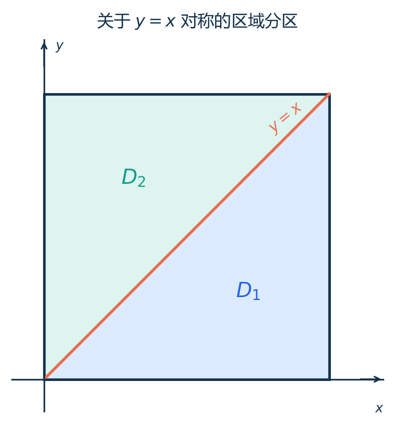
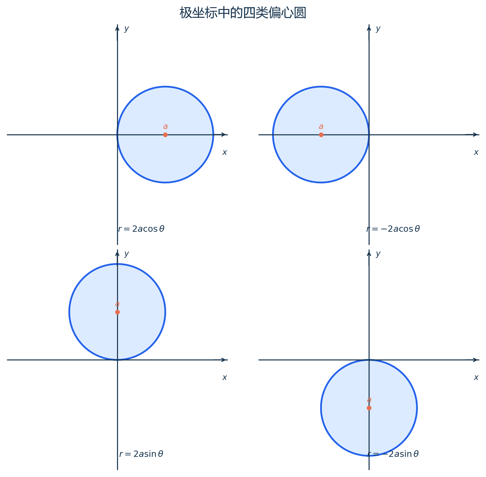

# 二重积分

> 原 PDF 第 60–63 页的逐页转写。原 PDF 里的蓝字、红字手写提示放在引用块里；“核对批注”是核对时加的说明，原结论没有改动；标“整理补充”的内容原 PDF 没有，是早先整理时加的，保留备查。

<!-- source: 原 PDF 第 60-63 页 -->

## 1. 基本概念与性质

<!-- p.60 -->

原 PDF 本页题为“二重积分知识点”，署名“澄潇宇、一只羊&南门朔”。第一个框为“二重变限积分求极限”。

> **二重变限积分求极限**（蓝字）
>
> 1. 交换积分次序，洛必达。
> 2. 二重积分中值定理。
>
> （需满足被积函数在这个点是非零因子。）（“需满足”为红字，其余为浅蓝字）

### 二重积分中值定理

原 PDF 印刷原文：（5）（中值定理）若 $f(x,y)$ 在闭区域 $D$ 上连续，则存在 $(\xi,\eta)\in D$，使得

$$
\iint_D f(x,y)\,dxdy=f(\xi,\eta)S_D.
$$

（整理补充）其中 $S_D$ 为区域 $D$ 的面积。旧文字的表述为：若 $f$ 在有界闭区域 $D$ 上连续，则至少存在 $(\xi,\eta)\in D$，使

$$
\iint_D f(x,y)\,\mathrm d\sigma=f(\xi,\eta)S_D.
$$

（整理补充）特别地，若 $f$ 在 $D$ 上不变号且积分不为零，常可把中值定理用于二重变限积分的极限；也可以逐次使用洛必达法则。

例如，若 $f$ 在 $(0,0)$ 附近连续，则

$$
\lim_{\substack{x\to0\\y\to0}}
\frac{\displaystyle\int_0^x\int_0^y f(u,v)\,\mathrm dv\mathrm du}{xy}=f(0,0).
$$

这是“二重变限积分求极限”的基本模型；若分母结构不同，应先整理成可用中值定理或逐次求导的形式。

**定义与常用性质（整理补充）**

原 PDF 第 60–63 页没有另列以下定义和性质框，保留早先整理的内容。

设有界闭区域 $D$ 被分成若干小块，面积为 $\Delta\sigma_i$，在第 $i$ 块内任取点 $(\xi_i,\eta_i)$。若极限

$$
\lim_{\lambda\to0}\sum_{i=1}^{n}f(\xi_i,\eta_i)\Delta\sigma_i
$$

存在且与分割、取点方式无关，则称其为 $f(x,y)$ 在 $D$ 上的二重积分，记作

$$
\iint_D f(x,y)\,\mathrm d\sigma.
$$

若 $f$ 在有界闭区域 $D$ 上连续，则二重积分存在。

常用性质：

$$
\iint_D[\alpha f+\beta g]\,\mathrm d\sigma
=\alpha\iint_Df\,\mathrm d\sigma+\beta\iint_Dg\,\mathrm d\sigma,
$$

$$
D=D_1\cup D_2,\quad D_1^\circ\cap D_2^\circ=\varnothing
\quad\Longrightarrow\quad
\iint_Df\,\mathrm d\sigma=\iint_{D_1}f\,\mathrm d\sigma+\iint_{D_2}f\,\mathrm d\sigma.
$$

若 $f\le g$，则

$$
\iint_Df\,\mathrm d\sigma\le\iint_Dg\,\mathrm d\sigma,
\qquad
\left|\iint_Df\,\mathrm d\sigma\right|\le\iint_D|f|\,\mathrm d\sigma.
$$

## 2. 先观察被积函数和区域

<!-- p.61 -->

原 PDF 的总框为“准备工作”，分为“观察被积函数”“画图，观察积分区域”“积分区域难以处理”三支。

### 2.1 面积与形心公式

**观察被积函数：线性函数 $f(x,y)=ax+by+c$**

> 拆开，利用形心公式计算。（浅蓝字）
>
> 被积函数是 $x$：$=\text{形心横坐标}\times D\text{ 面积}$；
>
> 被积函数是 $y$：$=\text{形心纵坐标}\times D\text{ 面积}$。（蓝字）
>
> 形心（几何中心）：对称轴交点。（浅蓝字）

**形心公式**　若区域 $D$ 的形心坐标为 $(\bar x,\bar y)$，则

$$
\iint_Dx\,dxdy=\bar xS_D,\qquad\iint_Dy\,dxdy=\bar yS_D.
$$

（整理补充）面积为

$$
S_D=\iint_D1\,\mathrm d\sigma.
$$

因此对线性函数 $f(x,y)=ax+by+c$，

$$
\iint_D(ax+by+c)\,\mathrm d\sigma=(a\bar x+b\bar y+c)S_D.
$$

对称区域的形心通常在对称轴的交点处。

### 2.2 绝对值与分区

**带绝对值，最大最小值，取整**

> 令绝对值内部等于零找到分界线。（蓝字）
>
> 利于区域可加性分区域拆开计算。（浅蓝字；“利于”按原图）

（整理补充）被积函数含绝对值、最大值、最小值或取整函数时，先求分界线，再利用区域可加性分区。例如遇到 $|g(x,y)|$，先画出 $g(x,y)=0$，在各子区域内去掉绝对值。

### 2.3 区域对称性

**画图，观察积分区域**

> **函数图像画不出来**（蓝字）：
>
> 1. 描特殊点，比如 $x=0$、$y=0$。（“描特殊点”为红字，其余为浅蓝字）
> 2. 将积分区域表达式中：
>    - $x$ 换成 $-x$，表达式不变则区域关于 $y$ 轴对称；
>    - $y$ 换成 $-y$，表达式不变则区域关于 $x$ 轴对称；
>    - $x,y$ 互换，表达式不变则区域关于 $y=x$ 对称。（变换与对称结论为红字，其余为浅蓝字）
>    - $(x,y)$ 换成 $(-x,-y)$，表达式不变则区域关于原点中心对称；
>    - $x$ 换成 $-y$、$y$ 换成 $-x$，表达式不变则区域关于 $y=-x$ 对称。（灰字）
> 3. 化成极坐标，观察 $r,\theta$ 走势，秒点画图。（红字；“秒点”按原图）

**积分区域有显著对称性：关于 $X$ 轴或 $Y$ 轴对称**

（1）若区域 $D$ 关于 $x$ 轴对称，则

$$
\iint_Df(x,y)\,dxdy=
\begin{cases}
2\displaystyle\iint_{D_{y\ge0}}f(x,y)\,dxdy,&f(x,-y)=f(x,y),\\[4pt]
0,&f(x,-y)=-f(x,y).
\end{cases}
$$

（2）若区域 $D$ 关于 $y$ 轴对称，则

$$
\iint_Df(x,y)\,dxdy=
\begin{cases}
2\displaystyle\iint_{D_{x\ge0}}f(x,y)\,dxdy,&f(-x,y)=f(x,y),\\[4pt]
0,&f(-x,y)=-f(x,y).
\end{cases}
$$

> $D$ 关于 $X$ 轴对称，$f$ 看 $y$ 的奇偶性；
>
> $D$ 关于 $Y$ 轴对称，$f$ 看 $x$ 的奇偶性。（蓝字）
>
> 偶倍奇零。（浅蓝字）

**关于原点对称**（手写）

（原图：一条关于原点中心对称的蓝色曲线，右上部分标 $D_1$，左下部分标 $D_2$。）

> 若 $f(-x,-y)=f(x,y)$，
>
> $$
> \iint_Df(x,y)\,dxdy=2\iint_{D_1}f(x,y)\,dxdy;
> $$
>
> 若 $f(-x,-y)=-f(x,y)$，
>
> $$
> \iint_Df(x,y)\,dxdy=0.
> $$
>
> （条件为蓝字，积分式为黑字）

**关于 $y=x$ 对称**

> 1. $D$ 关于 $y=x$ 对称。
> 2. $x,y$ 互换 $D$ 不变。（红字）
>
> ⇒ 区域 $D$ 的不等式组中 $x,y$ 互换，不等式组不变。
>
> ⇒ 区域 $D$ 的边界曲线方程中 $x,y$ 互换，方程不变。（蓝字）

（原图：三个蓝色区域图。第一幅是第一象限的单位正方形，下方橙字 $0\le x\le1,\ 0\le y\le1$，粉字 $x=0,y=0,x=1,y=1$；第二幅是以原点为圆心的圆，下方橙字 $x^2+y^2\le a^2,\ x^2+y^2=a^2$；第三幅是第一象限的四分之一圆，下方橙字不等式组 $x^2+y^2\le a^2,\ x\ge0,\ y\ge0$，粉字边界 $x^2+y^2=a^2,\ x=0,\ y=0$。）

**广义轮换对称**（粉字手写）

> $$
> \iint_Df(x,y)\,d\sigma=\iint_{D'}f(y,x)\,d\sigma.
> $$
>
> （$D$ 中 $x,y$ 互换。）（红字）

**整块区域用**（原图标三颗星）

$$
\iint_Df(x,y)\,dxdy
=\iint_Df(y,x)\,dxdy
=\frac12\iint_D[f(x,y)+f(y,x)]\,dxdy.
$$

**分两块使用**（原图标一颗星）

> $D$ 分成位于 $y=x$ 下方和上方的两块分别是 $D_1,D_2$。（浅蓝字）

（原图：第一象限单位正方形被红色直线 $y=x$ 分成两块，下方标 $D_1$，上方标 $D_2$，两轴上各标 $1$。）

> $D_2$：$x=0,y=1,y=x$；
>
> $x,y$ 互换：$y=0,x=1,x=y$ ⇒ $D_1$。（浅蓝字手写）

手写推导（黑字）：

$$
\iint_{D_2}f(x,y)\,dxdy=\iint_{D_1}f(y,x)\,dxdy,
$$

$$
\begin{aligned}
\iint_Df(x,y)\,dxdy
&=\iint_{D_1}f(x,y)\,dxdy+\iint_{D_2}f(x,y)\,dxdy\\
&=\iint_{D_1}f(x,y)\,dxdy+\iint_{D_1}f(y,x)\,dxdy\\
&=\iint_{D_1}[f(x,y)+f(y,x)]\,dxdy.
\end{aligned}
$$

> 若 $f(y,x)=f(x,y)$，
>
> $$
> \iint_Df(x,y)\,dxdy=2\iint_{D_1}f(x,y)\,dxdy;
> $$
>
> 若 $f(y,x)=-f(x,y)$，
>
> $$
> \iint_Df(x,y)\,dxdy=0.
> $$
>
> （条件为蓝字，积分式为黑字）

**积分区域难以处理**

- 做辅助线，构造对称区域。
- 增补区域。

（整理补充）各类对称对应的被积函数变换：

- $D$ 关于 $x$ 轴对称：考察 $f(x,-y)$。
- $D$ 关于 $y$ 轴对称：考察 $f(-x,y)$。
- $D$ 关于原点对称：考察 $f(-x,-y)$。
- $D$ 关于直线 $y=x$ 对称：交换 $x,y$ 后区域不变。
- $D$ 关于直线 $y=-x$ 对称：作变换 $(x,y)\mapsto(-y,-x)$ 后区域不变。

上式中的 $D_{y\ge0}=D\cap\{y\ge0\}$、$D_{x\ge0}=D\cap\{x\ge0\}$。其余对称情形同理，记忆为：**偶倍、奇零**。

当原区域本身不易利用对称性时，可增补成对称区域，或沿对称轴把区域拆开后换元配对。

## 3. 直角坐标计算与交换次序

<!-- p.60 -->

原 PDF 的“交换积分次序”分成“直角坐标”“极坐标”两支；极坐标换序的原文见第 5 节。

**直角坐标**

> 穿针，盯针。（蓝字；原图旁边有一根针）

**上限一定要比下限大**

（即穿针后定上下限应是从左到右，下到上。）

**Euler 可积不可求积**

> 可积：定积分存在。
>
> 不可求积：求不出原函数。（前半句为蓝字，解释为浅蓝字）

黑字手写列出的函数：

（1）

$$
e^{\pm x^2},\quad e^{1/x},\quad\frac1{\ln x}.
$$

（2）

$$
\sin x^2,\quad\sin\frac1x,\quad\frac{\sin x}{x}.
$$

（3）

$$
\cos x^2,\quad\cos\frac1x,\quad\frac{\cos x}{x},\quad\ldots
$$

> **核对批注（2026-10-16）**：“求不出原函数”在这里指不能用初等函数表示原函数，并不是原函数不存在；“定积分存在”还要结合具体积分区间判断，遇到奇点仍需审敛。上面的原文和函数列表保持不变。

**反三角函数**（手写）

$$
y=\sin x,\quad x\in\left[-\frac\pi2,\frac\pi2\right],\quad x=\arcsin y;
$$

$$
y=\cos x,\quad x\in[0,\pi],\quad x=\arccos y.
$$

（原图：左边画正弦曲线，主值段为红色，两端接蓝色曲线；红字标 $-\pi/2$、$\pi/2$，一条绿色水平线与曲线交于两点，绿色箭头分别标 $x=\arcsin y$、$x=\pi-\arcsin y$。右边画余弦曲线，$0$ 到 $\pi$ 的段为红色，两端为蓝色；红字标 $0,\pi$，两条绿色水平线分别示意正、负的 $y$ 值，绿色箭头标 $\arccos y$、$2\pi-\arccos y$。）

<!-- p.62 -->

原 PDF 的总框为“开始计算”，直角坐标分为以下三个框。

### 3.1 $x$ 型区域：先对 $y$ 积分

（一）$x$ 型区域　先确定 $x$ 的范围，再任取 $x$，沿 $y$ 轴正方向穿针确定 $y$ 的范围，穿入为下限，穿出为上限。

$$
\iint_Df(x,y)\,dxdy
=\int_a^b dx\int_{y_1(x)}^{y_2(x)}f(x,y)\,dy.
$$

> 内层积分被红框圈出，旁边红字标 $g(x)$。

（整理补充）若

$$
D=\{(x,y)\mid a\le x\le b,\ \varphi_1(x)\le y\le\varphi_2(x)\},
$$

则

$$
\iint_Df(x,y)\,\mathrm d\sigma
=\int_a^b\!\left[\int_{\varphi_1(x)}^{\varphi_2(x)}f(x,y)\,\mathrm dy\right]\mathrm dx.
$$

做题时固定 $x$ 画竖直线：穿入区域处为内层下限，穿出区域处为内层上限。

### 3.2 $y$ 型区域：先对 $x$ 积分

（二）$y$ 型区域　先确定 $y$ 的范围，再任取 $y$，沿 $x$ 轴正方向穿针确定 $x$ 的范围，穿入为下限，穿出为上限。

$$
\iint_Df(x,y)\,dxdy
=\int_c^d dy\int_{x_1(y)}^{x_2(y)}f(x,y)\,dx.
$$

> 内层积分被红框圈出，旁边红字标 $g(y)$。

**特殊适用情况**

> 1. 积分区域 $D$ 由参数方程给出（摆线）。
> 2. 极坐标逆问题。（浅蓝字）

（整理补充）若

$$
D=\{(x,y)\mid c\le y\le d,\ \psi_1(y)\le x\le\psi_2(y)\},
$$

则

$$
\iint_Df(x,y)\,\mathrm d\sigma
=\int_c^d\!\left[\int_{\psi_1(y)}^{\psi_2(y)}f(x,y)\,\mathrm dx\right]\mathrm dy.
$$

固定 $y$ 画水平线：从左向右读出 $x$ 的下限和上限。

> **易错点（整理补充）**：内层积分的上限必须大于下限。竖直“穿针”按从下到上，水平“穿针”按从左到右。

### 3.3 交换积分次序

<!-- p.60 -->

（整理补充）以下是早先整理的换序步骤与用途，对应本节开头原 PDF 第 60 页的“交换积分次序”框。

1. 先把原积分上下限改写为区域 $D$ 的不等式组。
2. 画出边界并标出交点。
3. 改用另一方向穿针；若一根针不能完整穿过区域，按临界点分段。
4. 重新写外层范围和内层上下边界。

交换次序的常见目的：

- 原积分的内层没有初等原函数；
- 换序后被积函数可直接积分；
- 方便把区域与被积函数中的结构配对。

前面 Euler 框列出的函数出现在累次积分的内层时，优先考虑交换积分次序，而不是强求原函数。

## 4. 一般变量代换与雅可比

<!-- p.62 -->

原 PDF 框标题为“压科比行列式”，旁边有直升机图案；正文中也写了“雅可比行列式”和“科比”。下面保留原图的说法。

> 1. 觉得积分区域和被积函数里的哪两块不舒服，令其等于 $u,v$。
> 2. 解出 $x,y$。
> 3. 换元三换（都换成 $u,v$ 的）积分：
>
> 区域换（$x,y$ 代入边界曲线）；
>
> 被积函数换；
>
> 微分换（雅可比行列式 × $dudv$）。（蓝字）
>
> 对二二换元用科比；一对一换元直接 $dx$、$dy$ 导出来。（浅蓝字）

手写公式（蓝字）：

> 令 $x=x(u,v),\ y=y(u,v)$，则
>
> $$
> J=\begin{vmatrix}
> \dfrac{\partial x}{\partial u}&\dfrac{\partial x}{\partial v}\\[4pt]
> \dfrac{\partial y}{\partial u}&\dfrac{\partial y}{\partial v}
> \end{vmatrix}.
> $$
>
> $$
> \iint_Df(x,y)\,dxdy
> =\iint_{D'}f[x(u,v),y(u,v)]|J|\,dudv.
> $$

手写极坐标例（浅蓝字）：

> $$
> x=r\cos\theta,\quad y=r\sin\theta,
> $$
>
> $$
> J=\begin{vmatrix}
> \cos\theta&-r\sin\theta\\
> \sin\theta&r\cos\theta
> \end{vmatrix}=r.
> $$

**平移变换**

> $x,y$ 加减常数换成 $u,v$。（蓝字）
>
> 积分区域换，被积函数换，微分换。（浅蓝字）
>
> 建立 $u,v$ 坐标系。（蓝字）

（整理补充）设 $x=x(u,v),\ y=y(u,v)$，且变换在区域内一一对应，雅可比行列式不为零，则

$$
J=\frac{\partial(x,y)}{\partial(u,v)},
\qquad
\iint_Df(x,y)\,\mathrm dx\mathrm dy
=\iint_{D'}f\bigl(x(u,v),y(u,v)\bigr)|J|\,\mathrm du\mathrm dv.
$$

换元必须“三换”：

1. 区域换：把边界全部改写为 $u,v$；
2. 被积函数换：把 $x,y$ 全部表示成 $u,v$；
3. 面积元换：乘 $|J|$。

若区域与被积函数中反复出现两个线性组合，可令

$$
u=\alpha x+\beta y,\qquad v=\gamma x+\delta y,
$$

再解出 $x,y$ 并计算雅可比。平移变换属于这一类。

## 5. 极坐标计算

<!-- p.60 -->

**交换积分次序：极坐标**

> **先 $\theta$ 后 $r$**（红字）：$xy$ 坐标系引射线。（蓝字）
>
> **先 $r$ 后 $\theta$**（红字）：
>
> 1. $xy$ 坐标系：任取 $r$，以原点为圆心，$r$ 为半径做圆弧，交积分区域，看 $\theta$ 范围。
> 2. 建立 $\theta$ 和 $r$ 自己的坐标系：穿针。（蓝字）
>
> （相当于直角坐标换序。）（浅蓝字）
>
> 考研从未考过，请同学们务必重视。（灰字；原文保留）

<!-- p.63 -->

**极坐标变换**　令

$$
\begin{cases}
x=r\cos\theta,\\
y=r\sin\theta,
\end{cases}
\quad\text{则 }dxdy=r\,d\theta dr.
$$

先确定 $\theta$ 的范围，再任取 $\theta$，从原点引射线确定 $r$ 的范围，穿入为下限，穿出为上限。

> 作射线。（黑字手写）

$$
\iint_Df(x,y)\,dxdy
=\int_\alpha^\beta d\theta\int_{r_1(\theta)}^{r_2(\theta)}
f(r\cos\theta,r\sin\theta)r\,dr.
$$

> **适用情况**（橙字）：
>
> 1. 被积函数含平方和。
> 2. 积分区域出现平方和（圆相关，玫瑰线，双纽线）。
>
> ！平方和消 $\theta$。（粉字）
>
> 3. 区域以极坐标表示的曲线给出（心形线，螺线）。
> 4. 被积函数为齐次（$xy$ 次数相同）函数 $f(y/x)$。（主体为蓝字，“平方和”“曲线”“齐次”“函数”为红字，括号里的“$xy$ 次数相同”为浅蓝字）
>
> ！齐次消 $r$。（粉字）

> **核对批注（2026-10-16）**：“齐次消 $r$”针对零次齐次的 $f(y/x)$；一般 $k$ 次齐次函数换成极坐标后带有 $r^k$，不一定消去 $r$。原图的“齐次（$xy$ 次数相同）”和“齐次消 $r$”原样保留。

**广义极坐标**

> 推广 $r$ 和 $\theta$。（蓝字）
>
> $r$ 是 $(x,y)$ 到圆心的距离，$\theta$ 是与 $x$ 轴正方向夹角。（浅蓝字）
>
> 画小三角形确定关系。（蓝字）

### 两类偏心圆

<!-- p.63 -->

原 PDF 标题为“两类重要的偏心圆”，标三颗星。

**（1）$X$ 轴**（红字）

黑字手写：

$$
r=2a\cos\theta\quad(a>0)
$$

$$
\Longleftrightarrow\ r^2=2ar\cos\theta
\Longleftrightarrow\ x^2+y^2=2ax
\Longleftrightarrow\ (x-a)^2+y^2=a^2.
$$

（原图：两个圆分别与原点相切，圆心在 $x$ 轴上，标 $-a$、$a$；左圆浅蓝字 $r=-2a\cos\theta$，右圆蓝字 $r=2a\cos\theta$。）

**（2）$Y$ 轴**（红字）

黑字手写：

$$
r=2a\sin\theta\quad(a>0).
$$

（原图：两个圆上下与原点相切，圆心在 $y$ 轴上，标 $a$、$-a$；上圆蓝字 $r=2a\sin\theta$，下圆浅蓝字 $r=-2a\sin\theta$。）

> $r=\pm2a\sin\theta\,/\,r=\pm2a\cos\theta$。（蓝字）
>
> **简记**（红字）：$r=$ 符号·直径·$s/c$。
>
> ⇒ $+$ 正半轴，$-$ 负半轴。（橙字）
>
> ⇒ $a$ 半径，$2a$ 直径。（蓝字）
>
> ⇒ $\cos$ 对应 $X$ 轴，$\sin$ 对应 $Y$ 轴。（浅蓝字）

（整理补充）四种偏心圆的完整直角坐标对应：

$$
r=2a\cos\theta\Longleftrightarrow(x-a)^2+y^2=a^2,
$$

$$
r=-2a\cos\theta\Longleftrightarrow(x+a)^2+y^2=a^2,
$$

$$
r=2a\sin\theta\Longleftrightarrow x^2+(y-a)^2=a^2,
$$

$$
r=-2a\sin\theta\Longleftrightarrow x^2+(y+a)^2=a^2.
$$

记忆：$\cos\theta$ 对应 $x$ 轴方向，$\sin\theta$ 对应 $y$ 轴方向；$a$ 是半径，$2a$ 是直径；正号偏向坐标轴正半轴，负号偏向负半轴。

（整理补充）本章的核心顺序：先画区域，再看对称性，最后决定用直角坐标、极坐标还是简单换元。极坐标变换为

$$
x=r\cos\theta,\qquad y=r\sin\theta,
\qquad\mathrm dx\mathrm dy=r\,\mathrm dr\mathrm d\theta.
$$

若区域可写成

$$
D=\{(r,\theta)\mid\alpha\le\theta\le\beta,\ r_1(\theta)\le r\le r_2(\theta)\},
$$

则

$$
\iint_Df(x,y)\,\mathrm dx\mathrm dy
=\int_\alpha^\beta\!\int_{r_1(\theta)}^{r_2(\theta)}
f(r\cos\theta,r\sin\theta)r\,\mathrm dr\mathrm d\theta.
$$

通常先定 $\theta$：从原点向区域作射线，射入点给 $r$ 的下限，射出点给 $r$ 的上限。若改成先对 $\theta$ 积分，可在 $r$-$\theta$ 平面重新画区域并换序。

优先考虑极坐标的信号：

- 被积函数含 $x^2+y^2$；
- 区域含圆、玫瑰线、双纽线、心形线或螺线；
- 被积函数为齐次函数，或含 $f(y/x)$；
- 区域本来就由极坐标方程给出。

## 6. 四等分与快速检查

<!-- p.63 -->

原 PDF 的“补充”分成“二重积分的被积函数是 1”“四等分型”两个框。

**二重积分的被积函数是 1**（黑字手写）

$$
\iint_D1\,dxdy=S_D.
$$

> **求 $D$ 面积**（红字）：
>
> 1. 在 $D$ 上对 $1$ 二重积分。
> 2. 定积分（极坐标方程）。（蓝字）

**四等分型**

> 积分区域关于 $xy$ 轴对称；
>
> ⇒（积分区域所有 $xy$ 套平方或绝对值）。
>
> 被积函数关于 $xy$ 都为偶函数；
>
> ⇒（被积函数所有 $xy$ 套平方或绝对值）。（主体为蓝字，箭头及括号内为浅蓝字）

黑字手写：

$$
\iint_Df(x,y)\,dxdy=4\iint_{D_1}f(x,y)\,dxdy.
$$

（原图：以原点为中心、关于两坐标轴对称的蓝色正方形，第一象限部分红字标 $D_1$。）

（整理补充）若区域关于两坐标轴都对称，且被积函数分别关于 $x,y$ 都是偶函数，则

$$
\iint_Df(x,y)\,\mathrm d\sigma
=4\iint_{D\cap\{x\ge0,\,y\ge0\}}f(x,y)\,\mathrm d\sigma.
$$

最后检查（整理补充）：

- 是否先画了区域并标出交点；
- 内层上下限是否按穿针方向书写；
- 分段点是否遗漏；
- 极坐标面积元是否乘了 $r$；
- 一般换元是否乘了 $|J|$；
- 是否能先用奇偶性、轮换对称或形心公式化简。

---

下一章：[常用图形与曲线](./09_常用图形与曲线.md)
