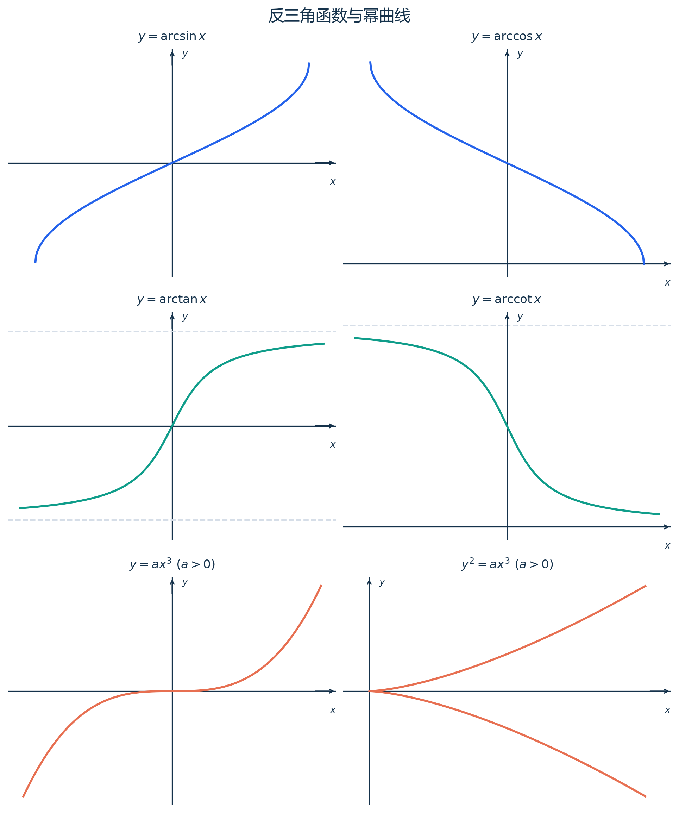
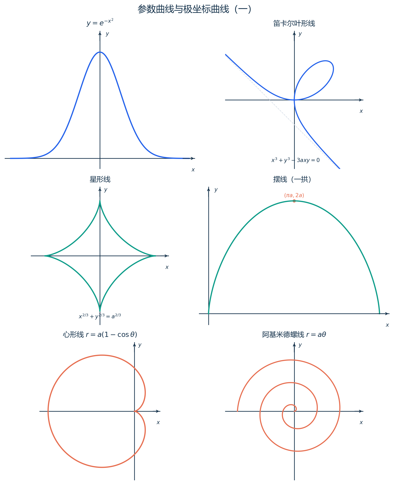
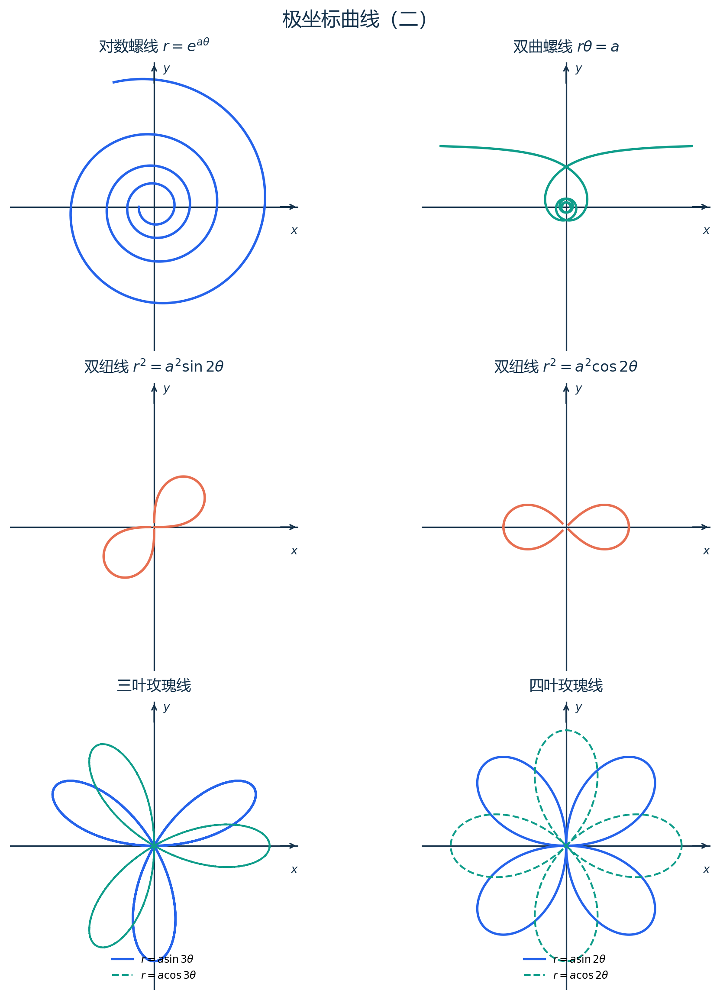

# 常用图形与曲线

> 原 PDF 第 64–66 页的逐页转写。原 PDF 里的蓝字、红字手写提示放在引用块里；“核对批注”是核对时加的说明，原结论没有改动；标“整理补充”的内容原 PDF 没有，是早先整理时加的，保留备查。本章原图以黑白图册为主，曲线方程及图中标注另行转成文字，已有重绘图保留。

<!-- source: 原 PDF 第 64-66 页 -->

## 1. 反三角函数

<!-- p.64 -->

原 PDF 本页题为“附录：几种常见的图形和曲线”，第一组题为“1. 反三角函数”。以下保留图册的编号、曲线名称与方程。

### 1.1 反正弦与反余弦

**（1）反正弦函数**

$$
y=\arcsin x.
$$

（原图：直角坐标系中一条经过原点的递增 S 形实线，上下两端各接一段虚线；横轴标 $-1,O,1$，纵轴标 $-\pi/2,\pi/2$。）

**（2）反余弦函数**

$$
y=\arccos x.
$$

（原图：一条从左上向右下的递减实线，两端接虚线；横轴标 $-1,O,1$，纵轴标 $\pi/2,\pi$。）

（整理补充）反三角函数的主值范围：

$$
y=\arcsin x,\qquad -1\le x\le1,\quad-\frac\pi2\le y\le\frac\pi2.
$$

图像单调递增，关于原点中心对称。

$$
y=\arccos x,\qquad -1\le x\le1,\quad0\le y\le\pi.
$$

图像单调递减，并满足

$$
\arcsin x+\arccos x=\frac\pi2.
$$

### 1.2 反正切与反余切

**（3）反正切函数**

$$
y=\arctan x.
$$

（原图：过原点的递增曲线，上、下各有一条水平虚线；横轴标 $O,1$，纵轴在两条虚线处标 $\pi/2,-\pi/2$。）

**（4）反余切函数**

$$
y=\operatorname{arccot}x.
$$

（原图：从左上向右下的递减曲线，左端趋近标为 $\pi$ 的水平虚线，右端趋近 $x$ 轴；横轴标 $O,1$，纵轴另标 $\pi/2$。）

（整理补充）反正切的定义域、主值范围及渐近线：

$$
y=\arctan x,\qquad x\in\mathbb R,\quad-\frac\pi2<y<\frac\pi2.
$$

水平渐近线为 $y=\pm\dfrac\pi2$。

按原资料采用的反余切主值：

$$
y=\operatorname{arccot}x,\qquad x\in\mathbb R,\quad0<y<\pi.
$$

水平渐近线为 $y=0$ 与 $y=\pi$。

## 2. 幂曲线

<!-- p.64 -->

**2. 三次抛物线**

$$
y=ax^3\quad(a>0).
$$

（原图：过原点、由第三象限伸向第一象限的递增曲线，坐标轴标 $x,y$，原点标 $O$。）

**3. 半立方抛物线**

$$
y^2=ax^3\quad(a>0).
$$

（原图：两支曲线从原点向右张开，关于 $x$ 轴对称，坐标轴标 $x,y$，原点标 $O$。）

（整理补充）$y=ax^3\ (a>0)$ 是过原点的单调递增奇函数曲线。半立方抛物线关于 $x$ 轴对称，只在 $x\ge0$ 一侧有图像，原点为尖点。

## 3. 参数曲线与特殊曲线

<!-- p.65 -->

### 3.1 钟形曲线

**4. 概率曲线**（原 PDF 的名称）

$$
y=e^{-x^2}.
$$

（原图：一条关于 $y$ 轴对称的钟形曲线，在 $y$ 轴处最高，两端逐渐靠近 $x$ 轴，原点标 $O$；没有另标最高点的数值。）

（整理补充）它关于 $y$ 轴对称，在 $x=0$ 处取最大值 $1$，且 $|x|\to\infty$ 时趋于 $0$。

### 3.2 笛卡尔叶形线

**5. 笛卡儿叶形线**（原 PDF 的写法）

$$
x^3+y^3-3axy=0,
$$

$$
x=\frac{3at}{1+t^3},\qquad y=\frac{3at^2}{1+t^3}.
$$

（原图：第一象限有一片闭合叶形，经过原点；另两支伸向第二、第四象限，旁边画一条左上到右下的斜直线。原点标 $O$，斜直线在两坐标轴负半轴附近各标 $a$，没有写负号。）

> **核对批注（2026-10-16）**：原图负半轴附近标的是 $a$。由方程可得斜渐近线为 $x+y+a=0$，截距坐标是 $-a$；图中的 $a$ 可理解为截距的长度。原图标注按原样记录，不补画负号。

（整理补充）曲线关于 $y=x$ 对称，并有斜渐近线。

### 3.3 星形线

**6. 星形线（内摆线的一种）**

$$
\begin{cases}
x=a\cos^3t,\\
y=a\sin^3t,
\end{cases}
\quad\text{或}\quad x^{2/3}+y^{2/3}=a^{2/3}\quad(a>0).
$$

（原图：四个尖点分别落在两坐标轴上的星形线，四条边向内凹；外有一个虚线大圆，右侧尖点附近有一个与大圆内切的虚线小圆；原点标 $O$，右侧尖点标 $a$。）

### 3.4 摆线

**7. 摆线**

$$
\begin{cases}
x=a(t-\sin t),\\
y=a(1-\cos t),
\end{cases}
\qquad(a>0).
$$

（原图：从原点开始向右的一拱摆线，两侧接相邻拱的部分曲线；一个虚线滚动圆与 $x$ 轴切于 $Q$，圆周点标 $A$，圆心到 $A$ 的半径标 $a$，该半径与竖直向下方向的夹角标 $t$；过最高点的竖直虚线下接 $x$ 轴，最高点标 $(\pi a,2a)$，原点标 $O$。）

（整理补充）一拱对应 $0\le t\le2\pi$，最高点为 $(\pi a,2a)$。

### 3.5 心形线

**8. 心形线（外摆线的一种）**

$$
x^2+y^2+ax=a\sqrt{x^2+y^2},
$$

$$
\rho=a(1-\cos\theta).
$$

（原图：向左展开、尖点在原点的心形线；内部有两个沿 $x$ 轴负半轴并排且相切的圆，两个圆内各标 $a$，坐标轴标 $x,y$，尖点标 $O$。）

（整理补充）旧文字用 $r$ 表示极径，写作左向心形线 $r=a(1-\cos\theta)$，直角坐标形式同上。

### 3.6 阿基米德螺线

**9. 阿基米德螺线**

$$
\rho=a\theta.
$$

（原图：围绕原点展开的螺线，既有实线段也有虚线段，外侧实线上的箭头指向左上；坐标轴标 $x,y$，原点标 $O$。）

（整理补充）旧文字写作 $r=a\theta$，半径随转角线性增长。

## 4. 螺线、双纽线与玫瑰线

<!-- p.66 -->

### 4.1 对数螺线与双曲螺线

**10. 对数螺线**

$$
\rho=e^{a\theta}.
$$

（原图：围绕原点逐渐向外展开的螺线，画有从原点向第一象限伸出的斜射线；内圈右下、外圈右侧、外圈左上各画方向箭头，坐标轴标 $x,y$，原点标 $O$。）

**11. 双曲螺线**

$$
\rho\theta=a.
$$

（原图：外侧曲线从右上向左下弯向原点附近，再绕原点形成缩小的圈；上方画一条水平直线，纵轴旁标 $a$，外侧曲线的箭头指向左，原点标 $O$。）

（整理补充）旧文字采用 $r$ 记极径：对数螺线 $r=e^{a\theta}$；双曲螺线 $r\theta=a$，即 $r=\dfrac a\theta$。

### 4.2 伯努利双纽线

**12. 伯努利双纽线（a）**

$$
(x^2+y^2)^2=2a^2xy,
$$

$$
\rho^2=a^2\sin2\theta.
$$

（原图：两片叶分别位于第一、第三象限，在原点相接，沿一条从左下到右上的斜线展开；两片叶中的斜线段各标 $a$，原点标 $O$。）

**13. 伯努利双纽线（b）**

$$
(x^2+y^2)^2=a^2(x^2-y^2),
$$

$$
\rho^2=a^2\cos2\theta.
$$

（原图：两片叶沿 $x$ 轴左右展开，在原点相接，每片叶的水平线段各标 $a$，原点标 $O$。）

> **核对批注（2026-10-16）**：旧文字把（a）型说成“沿 $y=x$ 与 $y=-x$ 方向展开”，与原图不符。这里已按原图改为第一、第三象限的两叶；它们沿 $y=x$ 方向展开，$y=-x$ 方向没有另一对叶。这是核对记录中的第 11 处转写修正，原 PDF 的方程没有改动。

（整理补充）旧文字以 $r$ 记极径：（a）型 $r^2=a^2\sin2\theta$，沿 $y=x$ 方向展开；（b）型 $r^2=a^2\cos2\theta$，沿 $x$ 轴方向展开。“伯努利双纽线”是曲线名，与伯努利微分方程不是同一个知识点。

### 4.3 玫瑰线

**14. 三叶玫瑰线**

原图左侧另有标题“三叶玫瑰线”，下方标（a）：

$$
r=a\sin3\theta\quad(a>0).
$$

（原图：三片叶分别朝向右上、左上和下方，每片叶中标最大极径 $a$；以原点为中心画多条射线，标 $\pi/3,2\pi/3,4\pi/3,5\pi/3$，曲线或射线旁标数字 $1,2,3,4,5,6$ 和方向箭头；原点标 $O$，坐标轴标 $x,y$。）

**15. 四叶玫瑰线**（原 PDF 此处的标题，照录）

右侧图下方标（b）：

$$
r=a\cos3\theta\quad(a>0).
$$

（原图：三片叶分别朝向右、左下和左上，每片叶中标 $a$，叶尖附近分别标 $1,2,3$，原点标 $O$。）

> **核对批注（2026-10-16）**：原 PDF 在 $r=a\cos3\theta$ 的三叶图上方写了“15. 四叶玫瑰线”，标题与方程、三片叶的图像不符，应是标题笔误。这里保留该标题和方程；真正的四叶图在本页下方，见下面的“$r=a\sin2\theta$”“$r=a\cos2\theta$”。

**四叶玫瑰线**（本页下方原图的标题）

（a）

$$
r=a\sin2\theta\quad(a>0).
$$

（原图：四片叶分别位于四个象限，朝两条对角线方向展开，在原点相接；坐标轴标 $x,y$，原点标 $O$。）

（b）

$$
r=a\cos2\theta\quad(a>0).
$$

（原图：四片叶沿两坐标轴的正、负方向展开，在原点相接；坐标轴标 $x,y$，原点标 $O$。）

（整理补充）旧文字的公式归类：

- 三叶玫瑰线：$r=a\sin3\theta$ 或 $r=a\cos3\theta$。
- 四叶玫瑰线：$r=a\sin2\theta$ 或 $r=a\cos2\theta$。

识图规律：$r=a\sin n\theta$ 或 $r=a\cos n\theta$ 中，$n$ 为奇数时通常有 $n$ 片花瓣，$n$ 为偶数时通常有 $2n$ 片花瓣；正弦型与余弦型的主要差别是整体旋转。

## 5. 画极坐标曲线的快速方法

<!-- p.66 -->

（整理补充）原 PDF 第 64–66 页没有这一组步骤，这是早先整理时加的，保留备查。对应前面的极坐标曲线图册：

1. 先看周期，确定最小作图区间。
2. 令 $r=0$，找曲线经过极点的角度。
3. 令 $r$ 取最大或最小值，找花瓣或凸起的方向。
4. 用 $\theta\mapsto-\theta$、$\theta\mapsto\pi-\theta$ 判断轴对称性。
5. 若出现负半径，按相反方向描点。

（整理补充）这些图形用于极限、积分区域、参数方程、弧长及二重积分画图。图像已根据原资料重新绘制，公式另行转为可编辑 LaTeX。

---

返回：[总目录](./00_总目录.md)
